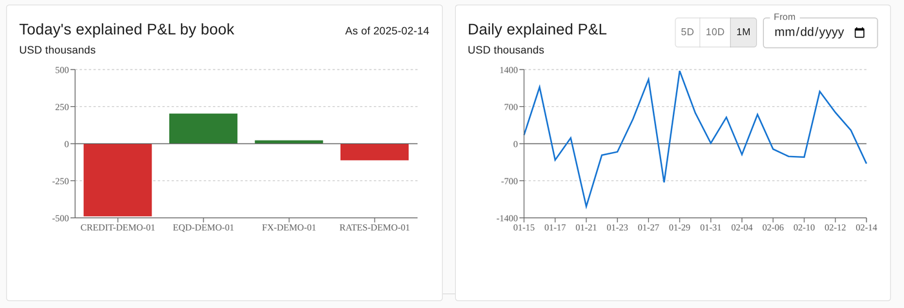

# Noam Samama

Software engineer working where **capital markets** meet **engineering**. Front Office Developer at **Crédit Agricole CIB** in Hong Kong from January 2027 (12-month VIE). Previously a developer intern on the exotic equity and fixed income derivatives platforms at **Société Générale CIB** (2026), working with front office on pricing and post-trade tools. Engineering graduate in Financial Engineering & AI (ESME, 2026).

I like turning quantitative finance into software that is tested, documented, and runs in production, not just in a notebook.

## Highlight: Cross-Asset Risk & P&L Dashboard

[Repository](https://github.com/noamsamama/cross-asset-risk-pnl-dashboard) · [Live demo](https://cross-asset-risk-pnl-dashboard.onrender.com) (synthetic data, may take about a minute to wake)

A risk and P&L view for a trading book across rates, credit, FX and equity derivatives.

- **Explained P&L** from sensitivities, per product family: DV01 for rates and govvies, DV01 + Spread01 for corporate bonds, CS01 for CDS, delta for FX and equity futures, delta/gamma/vega/theta for equity options.
- **Risk aggregation**: net and gross sensitivities per book, with native/USD reconciliation to the as-of FX rate.
- **Data-quality controls**: amber alerts for records that stay usable, red alerts for positions excluded from a calculation, and a hard `503` when the source data cannot be trusted.
- **Stack**: Python, pandas, FastAPI, React, TypeScript, Docker, GitHub Actions.

## Other projects

| Project | What it is | Stack |
|---|---|---|
| [Multi-Asset Swap Pricing Platform](https://github.com/noamsamama/multi-asset-swap-pricing-platform) · [live demo](https://multi-asset-swap-pricing-platform-we2vbgkirfdom3eq5zrkyu.streamlit.app/) | Pricing engine for 13 swap structures across rates, FX, inflation, equity, credit and commodities, built on real market curves | Python, NumPy, SciPy, Streamlit |
| [Tokenized Bond Settlement Lab](https://github.com/noamsamama/tokenized-bond-settlement-lab) | Bond settlement backend bridging on-chain atomic DvP (Solidity) with ISO 20022 (camt.054) reporting, fully tested with CI | Python, Django, DRF, Solidity, Hardhat |
| [Quant Portfolio Cockpit](https://github.com/noamsamama/quant-portfolio-cockpit) | LSTM forecasting, walk-forward backtesting and mean-variance optimization in an interactive dashboard | Python, TensorFlow, SciPy, Streamlit |

## Toolbox

**Finance**: derivatives pricing, swap curves, Greeks, sensitivity-based P&L explain, post-trade & settlement

**Engineering**: Python, Django, FastAPI, React, TypeScript, PostgreSQL, Docker, CI/CD (GitHub Actions, GitLab, Jenkins)

## Contact

[LinkedIn](https://www.linkedin.com/in/noam-samama)
